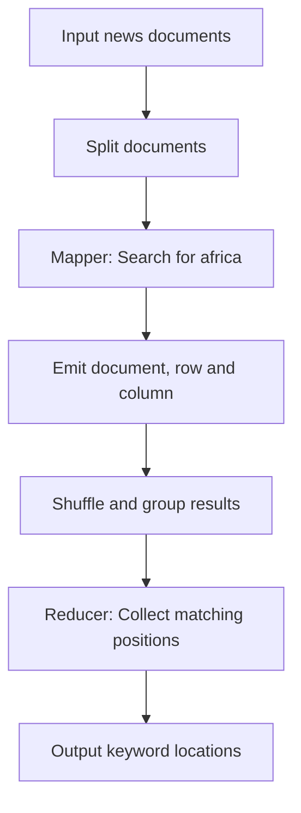

# Question 1 -- Data Analytics

This folder contains the R scripts, datasets and
supporting documentation for Question 1.

The analysis was conducted using RStudio.

### 1.1 MapReduce Logical Layout

The input documents are divided into records for processing.
Each mapper performs a case-insensitive search for "africa"
and emits the document name, row and column of each match.
The shuffle stage groups matching records by document.
The reducer collects the positions and produces the final
keyword-location results.
