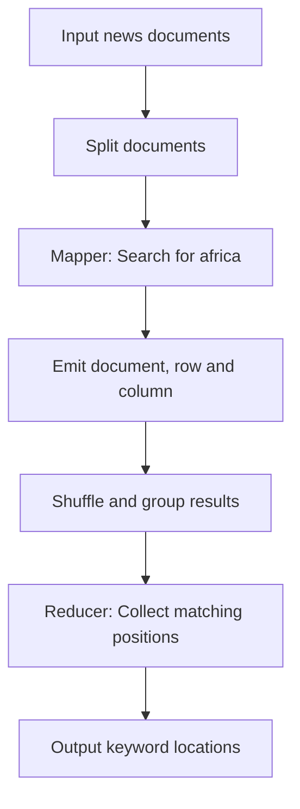

# Question 1 -- Data Analytics

This folder contains the R scripts, datasets and
supporting documentation for Question 1.

The analysis was conducted using RStudio.

### 1.1 MapReduce Logical Layout

The input documents are divided into records for processing.
Each mapper performs a case-insensitive search for "africa"
and emits the document name, row and column of each match.
The shuffle stage groups matching records by document.
The reducer collects the positions and produces the final
keyword-location results.

### 1.4 Hadoop MapReduce Configuration

The following settings describe how the keyword-search
application would be configured in Hadoop.

| Setting | Configuration |
|---|---|
| Framework | Hadoop MapReduce |
| Input format | TextInputFormat |
| Mapper | KeywordSearchMapper |
| Reducer | KeywordSearchReducer |
| Map output key | Text (document name) |
| Map output value | Text (row and column) |
| Output format | TextOutputFormat |
| Number of reducers | 1 |

The mapper searches each input record for the keyword
"africa" without case sensitivity. Intermediate records
are grouped by document and passed to the reducer, which
collects the matching positions.

Note: These are proposed Hadoop settings. The submitted
R implementation demonstrates the MapReduce logic rather
than executing a Hadoop job.
